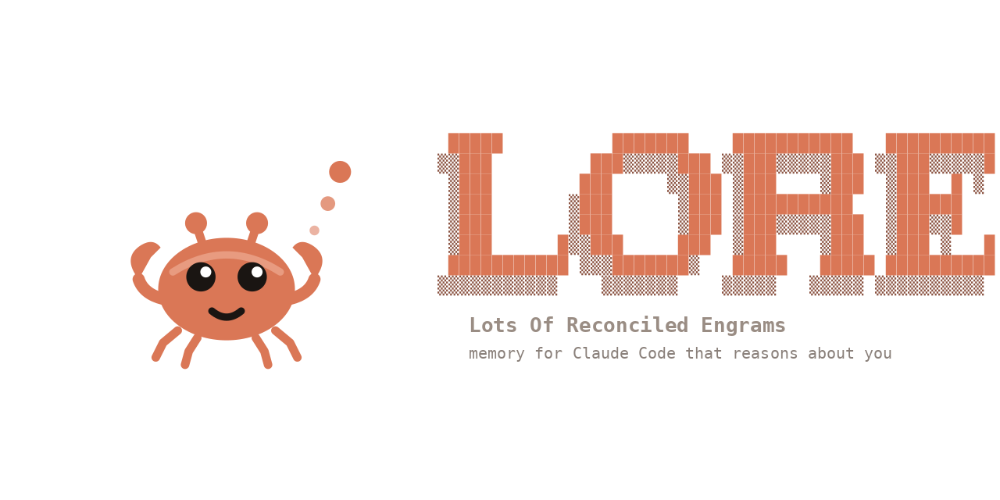
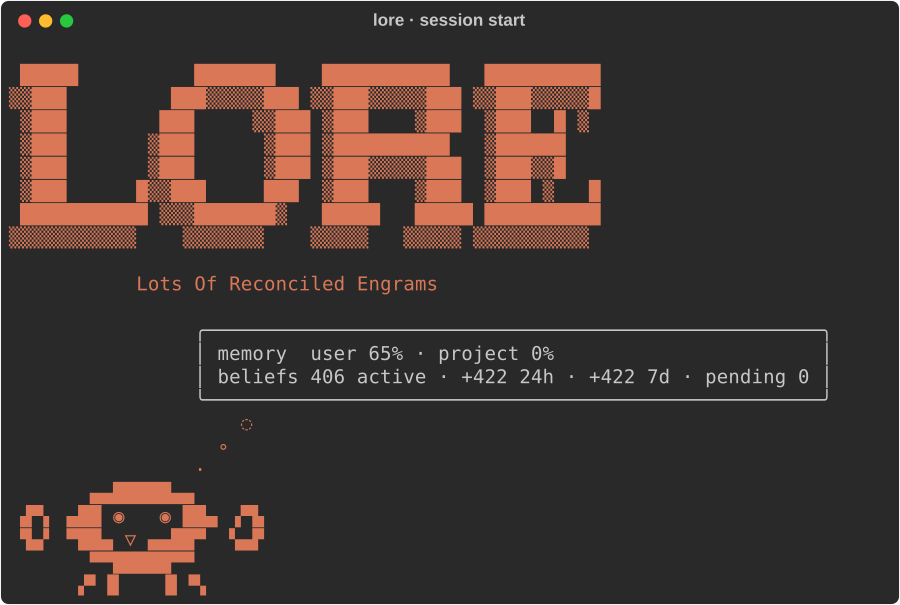

<p align="center"></p>

<p align="center">
  
  <a href="https://github.com/docwilde/LORE/releases"></a>
  
  
  
  
  <a href="LICENSE"></a>
</p>

# LORE — Lots Of Reconciled Engrams

**Shared local memory for Claude Code, Codex, and Gemini via Google Antigravity.**
LORE carries curated facts across sessions, keeps citations on derived beliefs,
and makes earlier conversations searchable. Each agent loads memory through
native hooks when configured.

[Claude Code setup](#claude-code) · [Codex setup](#codex) · [Google Antigravity setup](#google-antigravity)

> [!WARNING]
> **Beta.** Commands, caps, and configuration may change between releases.
> LORE indexes local transcripts; Claude review sends a scrubbed digest to
> the session's Anthropic endpoint. `/lore:setup` edits Claude settings.
> Hooks and model tools stage curated changes for review; the deriver writes
> beliefs directly. Sync is off until configured. Read [Data & safety](#data--safety).

LORE keeps recall separate from authority: a belief carries citations,
and relations between beliefs do not turn them into approved facts.

<p align="center"></p>

## What you get

LORE 0.62.36 adds standalone Antigravity memory hooks and AST codegraph queries
for Rust and Python. [Release notes](https://github.com/docwilde/LORE/releases/tag/v0.62.36)

- **Shared memory.** Claude Code, Codex, and Google Antigravity read capped
  user and project facts from the same local store. Host facts stay local.
- **Beliefs with evidence.** Query conclusions, citations, and their graph on
  demand, or enable experimental, bounded graph context.
- **Session search.** SQLite FTS5 searches indexed Claude Code, Codex,
  Antigravity, and DOXA transcripts locally.
- **File maps.** A short `path — purpose` guide to important project files.
- **AST codegraph.** Inspect Rust and Python definitions, imports, call sites,
  and module layout in the current Git worktree. [Codegraph commands](docs/manual.md#ast-codegraph)
- **Bounded pending review.** [Page through large queues](docs/pending-pages.md)
  while preserving human review of each complete, exact proposal.
- **Reviewed cleanup.** [Preview diagnostic retention and select orphaned
  codegraph snapshots](docs/retention.md) before applying a reviewed plan.
- **Tool evidence.** LORE [captures reported tool outcomes](docs/tool-evidence.md) by default. Link relevant observations to beliefs and learned recipes.
- **Learned skills.** Recipes carry outcome history and staged updates or retirement.
- **Local skill experiments.** [Compare exact pending coding skills](docs/skill-evaluation.md)
  against frozen tests before human approval. The experimental subscription
  coding adapter is disabled by default and requires an explicit budget for
  attempted calls and independent verification.
- **Cross-machine sync.** Signed hub, peer, or offline transfer, with optional
  [skill usage counters](docs/skill-usage-sync.md); off by default.
- **Native startup hooks.** Claude Code, Codex, and Google Antigravity load
  workspace memory when a session starts.

Engine-origin labels add context, not authority. The [manual](docs/manual.md)
explains the write gates, hooks, and belief model.
Use `/lore:filemap` to inspect file maps; `LORE_FILEMAP_CAP` and
`LORE_MACHINE_CAP` bound file maps and machine memory.

## Install

### Claude Code

Install Rust if you need to build the native carrier. [Rust installation](https://rustup.rs)

In a Claude Code session, run these commands in order.

```text
/plugin marketplace add docwilde/LORE
/plugin install lore@lore
/lore:setup
```

The first `/lore:setup` builds the native carrier in a private disk cache
when a compatible `lore-rs` is unavailable. Hooks use the installed carrier and never build during
startup. From a checkout, use `./task build` or `./task install`.
The carrier may use a newer patch release within the plugin’s major/minor
version; preview versions require an exact match.
`./task install` places `lore-rs` and `lore` in `~/.local/bin` by default;
keep that directory on `PATH`. Run setup after a plugin update so hooks have
a compatible carrier before the next session starts.

Native CLI, hooks, MCP and DOXA share saved caps, stage switches, review
model preferences, context refresh and sync transport settings from
`${CLAUDE_CONFIG_DIR:-$HOME/.claude}/settings.json`. Process environment
overrides saved values, including explicit empty values. A custom store
uses only process overrides unless it belongs to the chosen settings
directory. Store paths and identity remain process configuration. Saved credentials require a private, owned settings file.

`/lore:setup` walks each `/lore:doctor` finding behind its own confirmation: disabling Claude Code's built-in auto-memory, adding the permission allowlist, porting existing entries, priming the session index.

**First run:** review only looks forward, so run `/lore:backfill project` once to derive existing sessions into the belief store.

### Codex

With Rust and the Codex CLI installed, build the native carrier and register
LORE’s MCP server from your terminal.

```sh
git clone https://github.com/docwilde/LORE.git
cd LORE
./task install
codex mcp add lore --env LORE_ENGINE=codex -- \
  "$HOME/.local/bin/lore-rs" mcp --engine codex
```

Start a fresh Codex session to use LORE’s memory, beliefs, evidence, and session
search tools. Run `codex mcp list` to check the registration. Set `LORE_ROOT` if
your shared store lives outside `~/.claude/lore`.

#### Load memory at startup

Keep `~/.local/bin` on `PATH`. Add this `SessionStart` entry to `hooks.json`
in `${CODEX_HOME:-$HOME/.codex}`. Keep any hooks you already have.

```json
{
  "hooks": {
    "SessionStart": [
      {
        "matcher": "startup|resume|clear|compact|fork",
        "hooks": [
          {
            "type": "command",
            "command": "lore-rs hook --engine codex --event session-start",
            "timeout": 10,
            "additionalContextLimit": 16000
          }
        ]
      }
    ]
  }
}
```

Open Codex in your project and use `/hooks` to review and trust the LORE hook.
Start a fresh session to load the shared user and project snapshot. Review the
hook again after its command changes. [Codex hook trust](https://learn.chatgpt.com/docs/hooks#review-and-trust-hooks)

#### Recall past sessions

Run `lore index` to index local Codex, Claude Code, and DOXA transcripts. Use
`lore search "terms" --all` to find a match and `lore session <id>` to read it.
Indexing and search stay local and use SQLite FTS5.

Interactive CLI writes can apply directly. Hook and model writers stage
proposals for review with `lore pending`. The MCP tool `lore_remember` always
stages a proposal.

#### Install the local skill

From the checkout, link the [Codex skill](codex/skills/lore/SKILL.md) to give
Codex instructions for explicit recall and memory writes.

```sh
mkdir -p "${CODEX_HOME:-$HOME/.codex}/skills"
ln -s "$(pwd)/codex/skills/lore" "${CODEX_HOME:-$HOME/.codex}/skills/lore"
```

### Google Antigravity

With Rust and the Antigravity CLI (`agy`) installed, build LORE and install the
standalone plugin. Keep `agy` and the native `lore-rs` carrier on `PATH`. The
carrier installs to `~/.local/bin` by default.

```sh
git clone https://github.com/docwilde/LORE.git
cd LORE
./task install
agy plugin install "$PWD/antigravity"
```

Start a new Gemini conversation with one workspace open. Use the same LORE store
as your other agents. Set `LORE_ROOT` if you keep the store outside `~/.claude/lore`.

| Native hook | What it does |
| --- | --- |
| `SessionStart` | Loads the shared user and workspace memory into a new conversation. |
| `Stop` | Indexes scrubbed user and assistant messages locally when the agent is idle. |
| `PostToolUse` | Records reported tool outcomes for later review. |

Use `lore search "terms"` from the workspace to find indexed messages. Start
a fresh conversation to load an updated snapshot. Antigravity may retain the
startup context in its own history. Set `LORE_DISABLE_INJECT=1` to turn off
startup memory, `LORE_DISABLE_INDEX=1` to turn off transcript indexing, or
`LORE_TOOL_EVIDENCE=0` to turn off tool evidence recording. [Tool evidence guide](docs/tool-evidence.md)

### Windows

Native Windows is not supported yet. The `bin/lore` launcher and `./task`
require a POSIX shell, and the Rust carrier uses Unix file and process APIs.
CI checks Linux and macOS, but not Windows.

[WSL 2](https://learn.microsoft.com/windows/wsl/install) is the practical
route to try on a Windows machine: install Rust and run LORE and its Claude
Code or Codex integration inside the same Linux
distribution. Keep the checkout and LORE store in the distribution's Linux
filesystem (for example, under `~/`), then follow the install steps above.
This WSL 2 setup has not been verified in LORE CI; see the
[platform notes](docs/manual.md#platform-support) before relying on it.

## Memory and graph context

Claude Code refreshes curated memory on prompt submission when its content
changes by default (`LORE_REFRESH_ON_CHANGE=0` opts out). Codex and Antigravity
load startup snapshots. Read back current memory with `lore memory show` or
the MCP tool `lore_memory_list` where the server is configured.

Replacements and removals require a unique `--match`. Empty or whitespace-only
replacement text is refused; use `memory remove` to delete an entry:

```sh
lore memory replace --scope project --match "old wording" "replacement fact"
lore memory remove --scope project --match "obsolete fact"
```

An absent entry reports `match_not_found`; multiple matches report
`match_ambiguous`.

Graph context is experimental and off by default. Enable it in the shared
settings with `lore config set LORE_GRAPH_CONTEXT 1`. Its defaults are a
1,200-character budget (`LORE_GRAPH_CONTEXT_CAP`) and one relation hop
(`LORE_GRAPH_CONTEXT_HOPS`). The Claude Code prompt hook injects the bounded
block. In Codex, use the startup hook above and add a `UserPromptSubmit` hook
that calls `lore-rs hook --engine codex --event prompt` to retrieve graph
context on prompts. Startup memory stays available if graph retrieval fails.
With graph context enabled, `lore graph context --prompt "topic terms"` reads
the block explicitly. `lore graph stats`, `lore graph neighbours <id>`, and the
MCP tool `lore_belief_neighbours` support on-demand inspection and traversal.
Graph-retrieved beliefs retain their own evidence and citation status.

## Review and cleanup

Startup and refresh snapshots keep curated memory available when a pending
scan fails, reporting the pending count as unknown with a diagnostic code.
`lore pending` falls back to a bounded page when the ordinary listing is too
large. Request pages explicitly and inspect a selected proposal with:

```sh
lore pending page --limit 50
lore pending page --limit 50 --cursor '<next_cursor>'
lore pending show PROPOSAL_ID
```

Follow `next_cursor` until `has_more` is false; a page can have no visible
items and still have more to scan. Changed queues or expired cursors require
a fresh first page. Full-queue operations retain their 4,096-entry bound.
Approval and rejection still require human review of the complete current
proposal, bound to its exact bytes and file identity. See the
[pending page workflow](docs/pending-pages.md).

Preview cleanup with `lore trace retention-plan` or
`lore codegraph cleanup-plan`. Manual application requires human review of a
plan whose complete inventory and file proofs still match. Trace cleanup
protects recent captures and referenced evidence; codegraph cleanup removes
only the orphan snapshots explicitly selected by the owner. Automatic trace
retention is off by default; opt in with
`lore config set LORE_DIAGNOSTIC_RETENTION 1`. See
[retention and reviewed cleanup](docs/retention.md) for policies and application.

## Sync — one memory on every machine

Sync is **off until configured**. LORE records portable changes in a local
operation log; a configured transport moves signed operations between
machines. Unverified operations go to pending review; class-specific merge
rules preserve alternatives or stage conflicting content. Machine memory
stays on its own host.

- **Hub:** push and pull through the private `lore-hub` service, which stores operations without interpreting them.
- **Direct peer:** exchange operations between two machines without a hub.
- **Offline bundle:** `lore sync export` and `lore sync import` transfer signed memory, beliefs, file maps, proposals, and skills by file. Bundles exclude transcripts, session indexes, and credentials.

```sh
lore sync status                 # local state; no network call
lore sync login <token>          # hub authentication
lore sync                        # pull, then push
lore sync bootstrap              # initialize a new machine
lore sync export <new-file>      # create an offline bundle
lore sync import <file>          # verify and merge a bundle
lore sync resign --apply         # sign this machine's own backlog with the current key
lore sync seed --apply           # back-fill ops for state older than the log itself
```

Machines must share `LORE_SYNC_HMAC_KEY` to verify operations. You can choose
which data classes sync; see the [manual](docs/manual.md#sync--one-memory-on-every-machine)
for setup and the [protocol](docs/sync-protocol.md) for the wire format.

[Skill usage sync](docs/skill-usage-sync.md) is separately off by default.
Enable it on each participating machine with `lore sync classes +skill_usage`,
then run `lore sync seed --apply`. Signed per-author `uses`, `ok`, and `fail`
counters merge without double counting and preserve resets. Existing totals
stay local as a baseline; later increases can sync over the network or in
offline bundles. Reasons and review evidence stay local. Shared counts help
rank recipes; skill updates and retirement still require human review of an
exact proposal.

Signed historical belief operations with missing UID references are kept in
the log as quarantined data and shown by `lore sync status`; they do not enter
curated memory. A fresh direct-peer pull can replay a retained signed log when
an older hub copy cannot be replaced.

## Data & safety

- **Search stays local.** Indexing needs no embeddings or API calls.
- **Claude review uses the session's Anthropic endpoint.** LORE scrubs likely secrets before sending a digest.
- **Derived beliefs are written without approval.** The [read gate](docs/manual.md#the-belief-gate-sits-on-read-not-on-write) limits when they can influence an agent.
- **The write gate is advisory.** Interactive CLI calls can write curated memory directly; hook/model callers stage proposals. `LORE_WRITE_GATE=off` bypasses CLI staging and is not a security boundary.
- **Sync is opt-in.** Configured transports can carry memory, beliefs, proposals, skills, and selected scrubbed session text; treat the destination as private storage.
- **Setup changes Claude settings with confirmation.** `lore teardown` reverses those changes.

## DOXA — the native terminal

LORE provides a canonical **Rust module** for
[DOXA](https://github.com/docwilde/doxa): memory, beliefs, review, context and
session search share the existing files, SQLite store and signed sync log.
See the [native core guide](docs/native-core.md) for build commands and contracts.
The standalone CLI, provider hooks, MCP, review, and sync transports use
this native core. The Python `lore_core`
[library](docs/manual.md#lore_core-as-a-library) remains a compatibility reference
and interoperability test oracle.

## Reference

- **Manual** — commands, configuration, hooks, and store mechanics: [`docs/manual.md`](docs/manual.md)
- **Maintenance** — [large pending queues](docs/pending-pages.md), [retention and reviewed snapshot cleanup](docs/retention.md), and [optional skill usage sync](docs/skill-usage-sync.md)
- **Design rationale** — [`docs/user-model-channel-separation.md`](docs/user-model-channel-separation.md), [`docs/memory-proposal-quality.md`](docs/memory-proposal-quality.md), [`docs/write-gate.md`](docs/write-gate.md)
- **Sync** — the wire contract in [`docs/sync-protocol.md`](docs/sync-protocol.md), the design and merge rules in [`docs/plans/sync.md`](docs/plans/sync.md)
- **[CHANGELOG.md](CHANGELOG.md)** — release notes, newest first

## Lineage

Curated memory follows the [Hermes Agent](https://hermes-agent.nousresearch.com/docs/user-guide/features/memory)
pattern: hard caps, a reviewer that proposes but never applies, and stable
context with change-detected refresh in Claude Code and startup snapshots in
Codex and Antigravity. The belief layer uses [Honcho](https://github.com/plastic-labs/honcho)'s
deriver/dreamer/dialectic split, stored locally in SQLite.

The name means the accumulated knowledge of a craft — and, coincidentally, Data's brother in TNG. The logo's amber is a positronic wink at that.

## License

[AGPL-3.0](LICENSE) for everyone, including commercial use. A [commercial license](LICENSE-COMMERCIAL.md) is available where those terms don't fit. "LORE" and its mark are [reserved](TRADEMARK.md).
